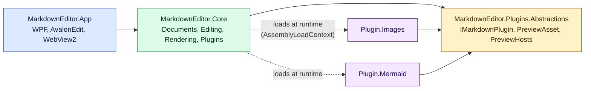

# Markdown Editor

A Windows 11 desktop Markdown editor/viewer with a live split preview, compliant with
[CommonMark 0.31.2](https://spec.commonmark.org/0.31.2/), and extensible through plugins.

## Features

- Split view: syntax-highlighted source (AvalonEdit) and live HTML preview (WebView2), debounced at 300 ms.
- New / Open / Save / Save As (Ctrl+N / Ctrl+O / Ctrl+S / Ctrl+Shift+S), drag & drop, open from command line.
- Unsaved-changes guard on New, Open and Close.
- Strict CommonMark core; all 652 spec examples are run as unit tests.
- Plugins loaded from `plugins/<name>/MarkdownEditor.Plugin.*.dll` (Help > Plugins lists them and any load failures).
- Bundled plugins:
  - **Pictures** (`images`) — relative image paths and size hints ``.
  - **Mermaid diagrams** (`mermaid`) — ```` ```mermaid ```` fenced blocks rendered with Mermaid 12.3.0 (bundled, offline), inline syntax errors, light/dark theme.

## Build & run

Requires the .NET 10 SDK and the WebView2 runtime (included with Windows 11).

```powershell
dotnet build MarkdownEditor.slnx
dotnet test --solution MarkdownEditor.slnx
.\src\MarkdownEditor.App\bin\Debug\net10.0-windows\MarkdownEditor.exe samples\welcome.md
```

## Architecture



| Project | Responsibility |
|---|---|
| `MarkdownEditor.Plugins.Abstractions` | Plugin contract shared by host and plugins (plus Markdig). |
| `MarkdownEditor.Core` | `Documents` (model, file store), `Editing` (`EditorSession` workflow), `Rendering` (Markdig pipeline, preview shell page, messages), `Plugins` (discovery, isolation). UI-agnostic and unit tested. |
| `MarkdownEditor.App` | WPF shell: editor, `PreviewHost` (WebView2 virtual hosts + web messages), dialogs. |
| `plugins/*` | Bundled plugins, staged into the app's `plugins/` folder on build. |

### Preview pipeline

1. Markdown → HTML by Markdig (strict CommonMark + plugin extensions).
2. The preview shell page is loaded once from `https://app.mdeditor.local/`; updates are posted as JSON
   web messages so the page never reloads (scroll position and plugin state are kept).
3. Plugin assets are served from `https://<plugin-id>.plugin.mdeditor.local/`, the open document's
   folder from `https://doc.mdeditor.local/`.

## Writing a plugin

1. Create a `net10.0` class library named `MarkdownEditor.Plugin.<Name>` under `plugins/` and import
   `..\Plugin.targets` (references the contract without copying shared assemblies).
2. Implement `IMarkdownPlugin` (public, parameterless constructor):
   - `Id`: lowercase letters, digits, hyphens (used as a host name).
   - `ConfigurePipeline(MarkdownPipelineBuilder)`: add Markdig extensions.
   - `PreviewAssets`: scripts/stylesheets relative to the plugin folder.
3. Preview scripts may register a post-render callback:

```js
window.mdeditor.onRender(async (root) => { /* transform rendered content */ });
// window.mdeditor.theme is "light" or "dark"
```

Plugins are trusted code; a plugin that fails to load or configure is skipped and reported, never fatal.

## Project tracking

Stories, issues, and assumptions are tracked in [GitHub Issues](https://github.com/Kalisen/markdown-editor/issues)
(label `Assumption` for decisions made without review, also listed in [docs/ASSUMPTIONS.md](docs/ASSUMPTIONS.md)).
