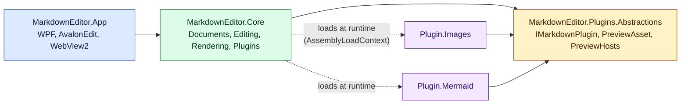
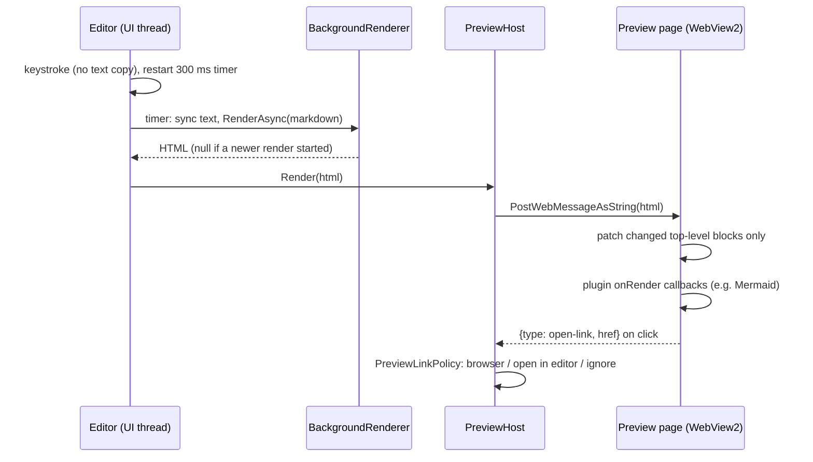

# Markdown Editor

A Windows 11 desktop Markdown editor/viewer with a live split preview, compliant with
[CommonMark 0.31.2](https://spec.commonmark.org/0.31.2/), and extensible through plugins.

## Features

- Split view: syntax-highlighted source (AvalonEdit) and live HTML preview (WebView2), debounced at 300 ms,
  rendered on a background thread with incremental preview updates and scroll sync.
- Links in the preview: web links open in the browser, links to other Markdown files open in the editor.
- New / Open / Save / Save As (Ctrl+N / Ctrl+O / Ctrl+S / Ctrl+Shift+S), drag & drop, open from command line.
- Unsaved-changes guard on New, Open and Close.
- Strict CommonMark core; all 652 spec examples are run as unit tests.
- Plugins loaded from `plugins/<name>/MarkdownEditor.Plugin.*.dll` (Help > Plugins lists them and any load failures).
- Bundled plugins:
  - **Pictures** (`images`) — relative image paths and size hints ``.
  - GitHub Flavored Markdown (validated against the GFM 0.29 spec examples):
    **Tables** (`tables`), **Task lists** (`task-lists`), **Strikethrough** (`strikethrough`),
    **Autolinks** (`autolinks`), **Disallowed raw HTML** (`tag-filter`).
  - GitHub.com extras: **Footnotes** (`footnotes`), **Alerts** (`alerts`), **Heading anchors**
    (`heading-anchors`), **Emoji shortcodes** (`emoji`), **Syntax highlighting** (`syntax-highlighting`,
    highlight.js 11.12.0 bundled), **Math** (`math`, KaTeX 0.19.1 bundled).
  - **Table of contents** (`toc`): `[TOC]` / `[[_TOC_]]` renders a nested list of heading links.
  - **Front matter** (`front-matter`): a leading YAML block is shown as a metadata table (as on GitHub).
  - **Wikilinks** (`wikilinks`): Obsidian-style `[[Note]]`, `[[Note|alias]]`, `[[Note#Heading]]` open the note in the editor.
  - **Mermaid diagrams** (`mermaid`) — ```` ```mermaid ```` fenced blocks rendered with Mermaid 12.3.0 (bundled, offline), inline syntax errors, light/dark theme.

## Build & run

Requires the .NET 10 SDK and the WebView2 runtime (included with Windows 11).

```powershell
dotnet build MarkdownEditor.slnx
dotnet test --solution MarkdownEditor.slnx
.\src\MarkdownEditor.App\bin\Debug\net10.0-windows\MarkdownEditor.exe samples\welcome.md
```

## Architecture



| Project | Responsibility |
|---|---|
| `MarkdownEditor.Plugins.Abstractions` | Plugin contract shared by host and plugins (plus Markdig). |
| `MarkdownEditor.Core` | `Documents` (model, file store), `Editing` (`EditorSession` workflow), `Rendering` (Markdig pipeline, preview shell page, messages), `Plugins` (discovery, isolation). UI-agnostic and unit tested. |
| `MarkdownEditor.App` | WPF shell: editor, `PreviewHost` (WebView2 virtual hosts + web messages), dialogs. |
| `plugins/*` | Bundled plugins, staged into the app's `plugins/` folder on build. |

### Preview pipeline



1. Markdown → HTML by Markdig (strict CommonMark + plugin extensions), off the UI thread; only the
   latest request's result is shown.
2. The preview shell (`index.html`, `preview.js`, `preview.css`) is loaded once from
   `https://app.mdeditor.local/`. Rendered HTML is posted as a plain string message; the page diffs it
   against the previous render by top-level block and replaces only the changed range, so unchanged
   content, scroll position and plugin output (rendered diagrams) are kept.
3. Plugin assets are served from `https://<plugin-id>.plugin.mdeditor.local/`, the open document's
   folder from `https://doc.mdeditor.local/`.

## Writing a plugin

1. Create a `net10.0` class library named `MarkdownEditor.Plugin.<Name>` under `plugins/` and import
   `..\Plugin.targets` (references the contract without copying shared assemblies).
2. Implement `IMarkdownPlugin` (public, parameterless constructor):
   - `Id`: lowercase letters, digits, hyphens (used as a host name).
   - `ConfigurePipeline(MarkdownPipelineBuilder)`: add Markdig extensions.
   - `PreviewAssets`: scripts/stylesheets relative to the plugin folder.
3. Preview scripts may register a post-render callback:

```js
window.mdeditor.onRender(async (root) => { /* transform rendered content */ });
// window.mdeditor.theme is "light" or "dark"
```

   Callbacks run after every update. Because unchanged blocks are kept between updates, a callback must
   be idempotent (skip content it already transformed) and may change the inside of top-level blocks but
   must not add or remove top-level nodes of `root`.
4. Scripts must be files (the preview CSP forbids inline script and `eval`).

Plugins are trusted code; a plugin that fails to load or configure is skipped and reported, never fatal.

## Security model

- **Documents are untrusted.** CommonMark allows raw HTML, so the preview shell enforces a strict
  Content-Security-Policy: scripts only from the app and plugin hosts (no inline script, no eval),
  no network requests, frames, objects or forms. Images may load from the document folder or `https:`
  (remote images can reveal that a document was opened).
- The preview cannot navigate away from its shell page; clicked links are classified by
  `PreviewLinkPolicy` (http/https/mailto open in the browser, Markdown files open in the editor,
  everything else is ignored). Messages from the page are validated and only accepted from the shell origin.
- Release builds disable WebView2 DevTools, browser shortcuts, autofill and password saving.
- **Plugins are trusted code** running with your privileges. Install the editor where only administrators
  can write (e.g. `Program Files`) and only add plugins you trust to its `plugins` folder.

## Performance and memory

Measured with a 650 KB / 4,000-section document (Release build, 40 edits with a render after each):

| | Before tuning | After tuning |
|---|---|---|
| WebView2 private memory after load | 1,006 MB | 714 MB |
| WebView2 private memory after 40 edits | 1,449 MB | 871 MB |
| App private memory after 40 edits | 591 MB | 566 MB |

What keeps memory down:
- Incremental DOM patching, plus `content-visibility: auto` so off-screen blocks are not laid out or painted.
- Editor text is copied only when rendering or saving, not on every keystroke.
- The saved state is kept as a SHA-256 hash, not a second copy of the text.
- HTML is posted as a plain string, with no JSON envelope copy.
- The undo stack is limited to 2,000 entries.
- The Mermaid SVG cache is bounded by size.
- The WebView2 memory target is set to Low while the window is minimized or inactive.
- `System.GC.ConserveMemory=5` makes the GC compact the Large Object Heap more eagerly.

Note: on machines with GPU overlay/driver DLLs injected into every process, a large share of the app's
private memory is independent of the editor (about 490 MB with an empty document on the test machine).

## Project tracking

Stories, issues, and assumptions are tracked in [GitHub Issues](https://github.com/Kalisen/markdown-editor/issues)
(label `Assumption` for decisions made without review, also listed in [docs/ASSUMPTIONS.md](docs/ASSUMPTIONS.md)). Review pass findings are summarized in
[docs/REVIEW-PASSES.md](docs/REVIEW-PASSES.md).
