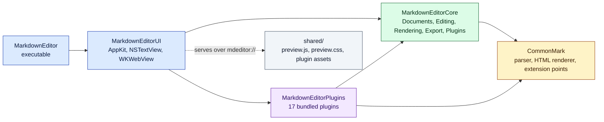
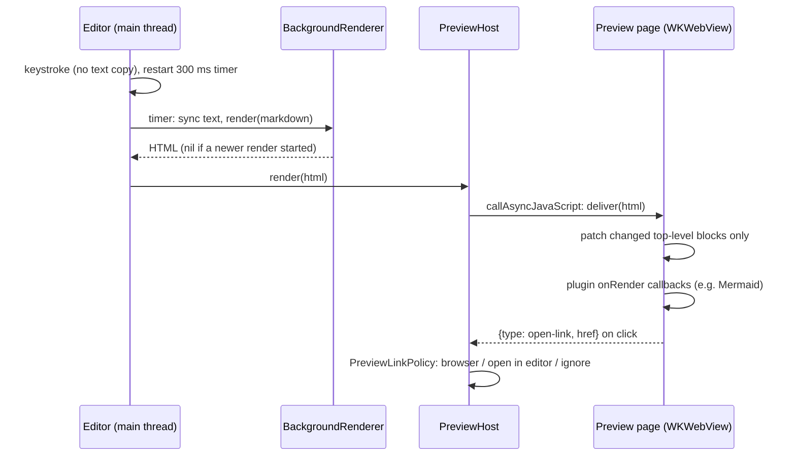

# Markdown Editor for macOS

A native macOS Markdown editor/viewer with a live split preview, compliant with
[CommonMark 0.31.2](https://spec.commonmark.org/0.31.2/), and extended by the same plugins as the
[Windows app](../windows/README.md). Written in Swift (AppKit, WKWebView), without third-party dependencies.
Licensed under the [MIT License](../LICENSE).

## Features

- Split view: syntax-highlighted source with line numbers and live HTML preview, debounced at 300 ms, rendered
  off the main thread with incremental preview updates and scroll sync in both directions.
- Links in the preview: web links open in the browser, links to other Markdown files open in the editor.
- New / Open / Save / Save As (⌘N / ⌘O / ⌘S / ⇧⌘S), Find (⌘F), drag & drop, open from Finder ("Open With"),
  the Dock or the command line.
- Detects when another program changes the open file and offers to reload it; File > Reload File (⌘R) reloads on demand.
- Unsaved-changes guard on New, Open, Close and Quit.
- File > Export to HTML (single file, stylesheets inlined, no scripts) or PDF (paginated, light theme), including
  diagrams, math and highlighting as rendered.
- Light and dark preview, following the system appearance.
- Strict CommonMark core; all 652 spec examples are run as unit tests.
- The 17 plugins of the Windows app (Help > Plugins lists them); the status bar lists the extensions used by the
  open document (hover for all plugins).

## Build, test and install

Requires Xcode 16 or later (Swift 6 toolchain) on macOS 14 or later. Run from the `macos` folder.

```sh
swift test                        # all tests
./Scripts/build-app.sh            # build/Markdown Editor.app
./Scripts/build-app.sh --install  # also copy to /Applications and register for "Open With"
open -a "Markdown Editor" ../samples/welcome.md
```

`build-app.sh` builds the release binary for this Mac's architecture, copies `shared/preview` and `shared/plugins`
into the bundle, generates the icon from `shared/icon/app-icon.svg` and signs ad hoc. The app is listed under
"Open With" for Markdown and text files; it never becomes their default app. The version is `VERSION` in the script.

To run without a bundle, point the app at the shared assets:

```sh
MARKDOWN_EDITOR_SHARED="$PWD/../shared" swift run MarkdownEditor ../samples/welcome.md
```

Logs: `log stream --predicate 'subsystem == "io.github.kalisen.markdown-editor"' --level debug`.

## Architecture



| Target | Responsibility |
|---|---|
| `CommonMark` | Markdown engine: block and inline parsers, document tree with source lines, HTML renderer. `MarkdownPipelineBuilder` exposes the extension points plugins use: block starts, inline starts, emphasis delimiters, document processors, rendering wrappers. |
| `MarkdownEditorCore` | Same domains as `MarkdownEditor.Core` on Windows: `Documents`, `Editing` (`EditorSession`), `Rendering` (preview page, messages, link policy, resources), `Export`, `Plugins` (contract, catalog). UI-agnostic. |
| `MarkdownEditorPlugins` | The bundled plugins, one folder each. Their preview assets are in `shared/plugins/<plugin-id>/assets`. |
| `MarkdownEditorUI` | `MainWindowController`, `MarkdownTextView` (editor, highlighting, line numbers), `PreviewHost` (WKWebView, URL scheme handler, page bridge), scroll synchronization, dialogs, menus. |
| `MarkdownEditor` | Entry point. |

### Preview pipeline



1. The preview shell (`index.html`, generated; `preview.js` and `preview.css`, shared with Windows) is loaded once
   from `mdeditor://app.mdeditor.local/`.
2. Plugin assets are served from `mdeditor://<plugin-id>.plugin.mdeditor.local/`, the open document's folder from
   `mdeditor://doc.mdeditor.local/`. `PreviewResources` refuses any path outside those folders.
3. `preview.js` talks to its host through WebView2's `window.chrome.webview`. A user script injected by
   `PreviewHost` provides that interface over a WebKit message handler, so the script is the same file on both platforms.

## Differences with the Windows app

| Topic | Windows | macOS |
|---|---|---|
| Markdown engine | Markdig | Own `CommonMark` target |
| Plugins | DLLs loaded from `plugins/` at startup | Compiled into the app (`BundledPlugins`) |
| Preview origins | `https://*.mdeditor.local` (WebView2 virtual hosts) | `mdeditor://*.mdeditor.local` (URL scheme handler); the Content-Security-Policy lists each plugin origin |
| Task list items | `[x]` anywhere in a list item | Only at the start of the item, followed by whitespace (GFM) |
| Strikethrough | Tilde runs of different lengths can match | Opening and closing runs have the same length (as on GitHub) |
| Scroll sync anchors | Blocks rendered by Markdig | Also Mermaid diagrams, the table of contents and table rows |
| HTML export | Pictures keep their preview URL | Pictures are referenced relative to the document |
| Preview theme | Read at startup | Follows appearance changes while running |
| Reload File | F5 | ⌘R |
| Window title | `name* - Markdown Editor` | Document name, edited mark and proxy icon |
| Installer, signing | Inno Setup installer, self-signed certificate | Built and signed ad hoc on the Mac that runs it |

## Writing a plugin

1. Add a folder under `Sources/MarkdownEditorPlugins` with a type implementing `MarkdownPlugin`:
   - `id`: lowercase letters, digits, hyphens (used as a host name).
   - `configurePipeline(_:)`: add extensions to the `MarkdownPipelineBuilder`.
   - `previewAssets`: scripts/stylesheets relative to `shared/plugins/<plugin-id>`.
   - Optionally implement `DocumentFeatureProbe.isUsed(by:)` so the status bar can report when the plugin applies.
2. Add it to `BundledPlugins.all`, and to the Windows app to keep both in step.
3. Preview scripts follow the same rules as on Windows (see
   [Writing a plugin](../windows/README.md#writing-a-plugin)): idempotent `window.mdeditor.onRender` callbacks,
   files only (no inline script, no `eval`).

## Security model

- **Documents are untrusted.** The preview shell enforces a strict Content-Security-Policy: scripts only from the
  app and plugin origins (no inline script, no eval; WebAssembly compilation is allowed for Graphviz), no network
  requests, frames, objects or forms. Images may load from the document folder or `https:` (remote images can
  reveal that a document was opened).
- The preview cannot navigate away from its shell page; clicked links are classified by `PreviewLinkPolicy`
  (http/https/mailto open in the browser, Markdown files open in the editor, everything else is ignored).
  Messages from the page are validated and only accepted from the shell page.
- The web inspector is only enabled in debug builds.
- The app is not sandboxed: it reads and writes the files you open and save.

## Privacy

The app does not transfer any information to other networked systems unless specifically requested by the user.
The only network access is the user's own: opening a web link from the preview in the browser, and loading remote
(`https:`) images referenced by the document being viewed.
